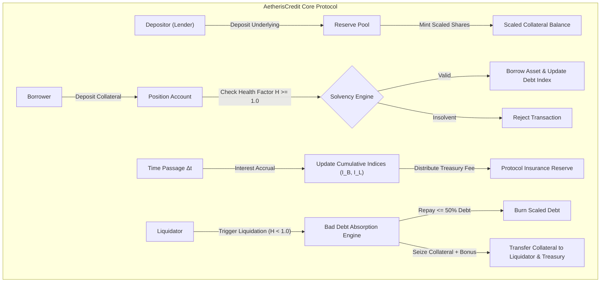
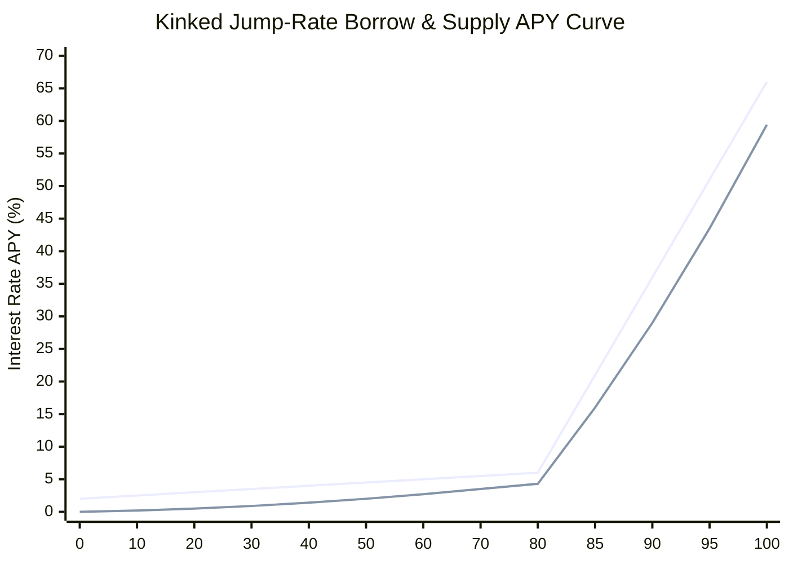

# AetherisCredit

[](https://github.com/ZengLLQ/aetheris-credit/actions)
[](https://www.cairo-lang.org/)
[](https://starknet.io/)
[](https://docs.swmansion.com/scarb/)
[](LICENSE)

**AetherisCredit** is an isolated-risk decentralized lending, borrowing, and atomic flash liquidity protocol implemented in Cairo 2.21 on Starknet. It incorporates dual-slope kinked jump-rate interest models, continuous 27-decimal Ray-precision compounding, share-indexed normalized debt accounting, multi-asset health factor solvency verification, and an incentive-aligned liquidation engine with protocol insurance buffer splitting.

---

## Architectural Overview



---

## Mathematical Formulations

### 1. Dual-Slope Kinked Interest Rate Model

The reserve utilization rate $U$ represents the fraction of deposited liquidity currently borrowed:

$$U = \frac{\text{TotalBorrows}}{\text{AvailableCash} + \text{TotalBorrows}}$$

The instantaneous annual borrow interest rate $R_{\text{borrow}}(U)$ is defined as a two-piece piecewise linear function with a steep penalty slope $\text{Slope}_2$ past the optimal utilization point $U_{\text{optimal}}$:

$$R_{\text{borrow}}(U) = \begin{cases} R_0 + \frac{U}{U_{\text{optimal}}} \times \text{Slope}_1 & \text{if } U \le U_{\text{optimal}} \\ R_0 + \text{Slope}_1 + \left( \frac{U - U_{\text{optimal}}}{1 - U_{\text{optimal}}} \right) \times \text{Slope}_2 & \text{if } U > U_{\text{optimal}} \end{cases}$$

Where:
- $R_0$ is the base interest rate (e.g. $2.0\%$).
- $\text{Slope}_1$ is the optimal target rate adder below kink (e.g. $4.0\%$).
- $\text{Slope}_2$ is the jump rate slope past the kink (e.g. $60.0\%$).

The supply (liquidity) interest rate $R_{\text{supply}}(U)$ received by depositors accounts for the protocol reserve factor $\gamma$ (e.g. $10\%$):

$$R_{\text{supply}}(U) = R_{\text{borrow}}(U) \times U \times (1 - \gamma)$$



### 2. Ray-Precision Continuous Interest Compounding

To avoid cumulative rounding drift, all indices and interest calculations operate at $10^{27}$ (Ray) precision. Over an elapsed duration $\Delta t = t - t_{\text{last}}$ seconds, the compounding factor $F(\Delta t)$ is computed using a 2nd-order Taylor expansion:

$$F(\Delta t) = \exp\left( \frac{R_{\text{borrow}} \times \Delta t}{\text{SecondsPerYear}} \right) \approx 1 + x + \frac{x^2}{2!} \quad \text{where } x = \frac{R_{\text{borrow}} \times \Delta t}{\text{SecondsPerYear}}$$

The cumulative borrow index $I_B(t)$ and liquidity index $I_L(t)$ update dynamically:

$$\begin{aligned}
I_B(t) &= I_B(t_{\text{last}}) \times F(\Delta t) \\
I_L(t) &= I_L(t_{\text{last}}) \times \left(1 + \frac{R_{\text{supply}} \times \Delta t}{\text{SecondsPerYear}}\right)
\end{aligned}$$

### 3. Scaled Share Accounting

Users hold internal scaled shares $S$ rather than nominal token balances, completely eliminating per-user loop accruals:

$$\begin{aligned}
\text{ScaledShares} &= \frac{\text{NominalAmount} \times 10^{27}}{I(t)} \\
\text{NominalAmount} &= \frac{\text{ScaledShares} \times I(t)}{10^{27}}
\end{aligned}$$

### 4. Multi-Asset Solvency & Health Factor

An account is solvent if its Health Factor $H \ge 1.0 \times 10^{18}$ (WAD):

$$H = \frac{\sum_i \text{Collateral}_i \times P_i \times \text{LT}_i}{\sum_j \text{Borrow}_j \times P_j}$$

Where:
- $P_i, P_j$ are normalized oracle asset prices in USD.
- $\text{LT}_i$ is the liquidation threshold for collateral asset $i$ (e.g. $80\%$).
- $\text{LTV}_i$ defines maximum initial borrow capacity ($\text{LTV}_i \le \text{LT}_i$, e.g. $75\%$).

### 5. Liquidation Dynamics & Bonus Split

When $H < 1.0$, liquidators can repay up to the Close Factor $\text{CF} = 50\%$ of outstanding debt:

$$\text{RepayLimit} = \text{TotalDebt} \times 0.50$$

The liquidator receives equivalent collateral valued at oracle market price plus the liquidation bonus $B$ (e.g. $5\%$):

$$\text{CollateralSeized} = \frac{\text{DebtRepaid} \times P_{\text{debt}} \times (1 + B)}{P_{\text{collateral}}}$$

The bonus is split between the liquidator ($90\%$) and the protocol insurance treasury ($10\%$) to build autonomous reserves against bad debt.

---

## Smart Contract Architecture

| Module | Source File | Description |
| :--- | :--- | :--- |
| **Math** | `src/math.cairo` | Wad ($10^{18}$) and Ray ($10^{27}$) fixed-point arithmetic, half-up rounding, and continuous compounding. |
| **Types** | `src/types.cairo` | Structs for `ReserveConfig`, `ReserveData`, `InterestRateConfig`, `UserPosition`, and `LiquidationResult`. |
| **Interest** | `src/interest.cairo` | Dynamic kinked jump-rate model computing instantaneous borrow APY and supply APY. |
| **Reserves** | `src/reserves.cairo` | Cumulative index updates, interest accruals, treasury fee collection, and share transformations. |
| **Risk** | `src/risk.cairo` | Health factor computation, weighted collateral valuations, and LTV borrow capacity limits. |
| **Liquidations** | `src/liquidations.cairo` | 50% close factor enforcement, liquidation bonus allocation, and underwater position debt haircuts. |
| **Flash Loans** | `src/flash.cairo` | Atomic flash borrow fee calculation (9 bps) and 80/20 LP-treasury fee split. |
| **Oracle** | `src/oracle.cairo` | 18-decimal normalized price conversion router and circuit breaker price sanity verification. |
| **Market** | `src/market.cairo` | Full Starknet contract orchestrating deposits, withdrawals, borrows, repayments, and liquidations. |

---

## Test Verification Suite

The protocol includes 16 automated tests covering fixed-point math, compounding accuracy, kink transitions, risk thresholds, liquidations, and oracle boundaries:

```bash
# Build and run tests with Scarb
scarb build
scarb test
```

### Verified Invariants

1. **Wad & Ray Arithmetic:** Validated multiplication, division, and conversions between $10^{18}$ and $10^{27}$.
2. **Interest Compounding:** Confirmed 2nd-order Taylor continuous compounding factors strictly exceed linear approximations over multi-month horizons.
3. **Kinked Jump-Rate Transitions:** Verified smooth slope below $80\%$ optimal utilization and steep jump activation past the kink.
4. **Reserve Accrual Cycle:** Verified index progression and protocol fee accumulation over 180 simulated days.
5. **Solvency & Health Factor:** Verified $H = 1.60$ for healthy accounts and $H = 0.80$ for underwater accounts triggering liquidation eligibility.
6. **Liquidation Bonus & Close Factor:** Verified exact collateral seizure, $50\%$ close factor cap, and treasury fee splitting.
7. **Severe Market Crash (Debt Haircut):** Verified underwater accounts with collateral less than debt cap seizure to available collateral without revert.
8. **Flash Loan Split:** Verified 9 bps fee computation with $80\%$ distributed to LPs and $20\%$ to protocol treasury.

---

## License

This project is licensed under the [MIT License](LICENSE).
